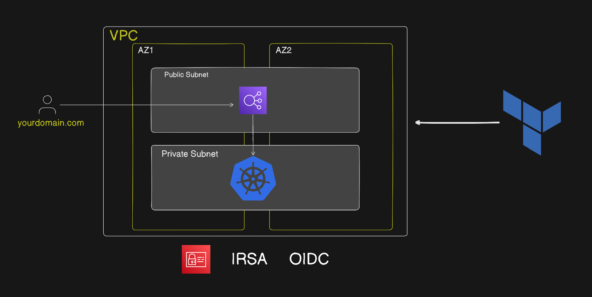
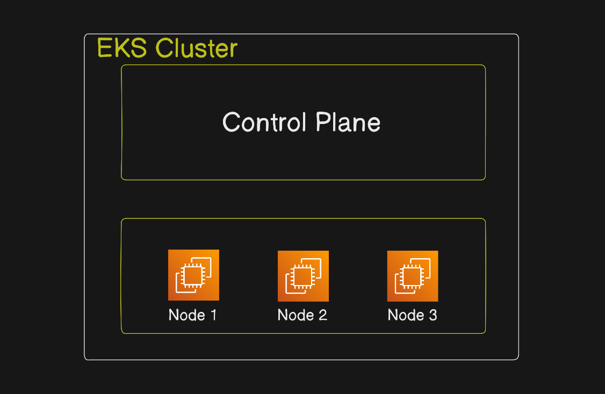
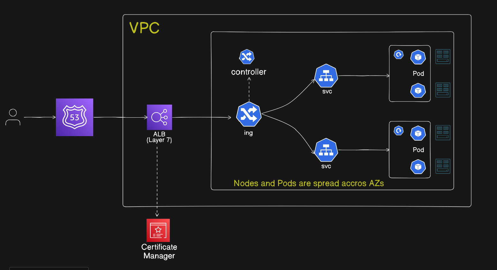

# **Production-Grade AWS EKS Deployment with ALB, TLS & Route53 (Terraform Automated)**

## 📌 Overview

This project provisions a production-ready private Amazon EKS cluster using Infrastructure as Code (Terraform) and deploys microservices using Kubernetes with:

- AWS Load Balancer Controller (ALB)

- Kubernetes Ingress

- TLS termination using ACM

- Route53 DNS configuration

- Host-based routing

- Bastion host for secure access

The entire infrastructure layer is automated using Terraform.

## Architecture
Core AWS Services Used
- Amazon Web Services
- Amazon EKS
- AWS Application Load Balancer
- Amazon Route 53
- AWS Certificate Manager





## Infrastructure Provisioned with Terraform
### Networking (Custom VPC)
- VPC
- Public Subnets
- Private Subnets
- Internet Gateway (IGW)
- NAT Gateway
- Route Tables
- Security Groups

#### Architecture model:
```
Public Subnet:
  - Bastion Host
  - NAT Gateway
  - ALB

Private Subnet:
  - EKS Worker Nodes
```

### Private EKS Cluster
- Private Endpoint Enabled
- IAM Roles & Policies
- OIDC Provider
- IRSA (IAM Roles for Service Accounts)
- Managed Node Groups

#### Security-first design:
- No public access to worker nodes
- Access only via Bastion host

### Bastion Host
Used for:
- Secure SSH access
- Kubectl access to private cluster
- Helm installation
- Controller installation

# **Prerequisites Setup for This Repository (AWS CLI + Terraform via Chocolatey)**

Before running this EKS Terraform project, install the required tools on your system using Chocolatey.

# **1. Install Chocolatey (if not already installed)**

Open PowerShell as Administrator and install Chocolatey:

Set-ExecutionPolicy Bypass -Scope Process -Force; [System.Net.ServicePointManager]::SecurityProtocol = [System.Net.ServicePointManager]::SecurityProtocol -bor 3072; ` iex ((New-Object System.Net.WebClient).DownloadString('https://community.chocolatey.org/install.ps1'))

Verify installation:

choco -v

# **2. Install AWS CLI using Chocolatey**

Install AWS CLI:

choco install awscli -y

Verify:

aws --version

# **3. Install Terraform using Chocolatey**

Install Terraform:

choco install terraform -y

Verify:

terraform -version

# **EKS Project Run Steps (Terraform)**

## **1.Clone the repository to local: create a empty directory in local .Then clone it**

git clone https://github.com/harathi-mutyam/PRODUCTION-EKS.git

cd PRODUCTION-EKS

## **2. Go to Terraform working directory**

Based on your instructions:

cd eks-project/terraform/eks

Make sure this folder contains: main.tf ,eks.tf,vpc.tf,provider.tf,dev.tfvars

## **3. Configure AWS CLI (mandatory):** for that go to browser create a IAM user (eks-user) in aws console for this project save access key and secret keys locally

aws configure

Set:

AWS Access Key : give your access key
Secret Key  : give your secret key
Region → us-east-1
json

## **4. Create S3 backend bucket (if not already created)**

Through aws console or through command

aws s3 mb s3://your-terraform-state-bucket --region us-east-1

in **backend.tf** change the bucket name 

bucket       = "backend-bucket-final-6526"   #create s3 bucket through aws console .and replace bucket name here

Update the region based on your AWS region. in backend block 


### In dev.tfvars 

Change Ami id of Ubuntu Server Based on region

ami_id        = "ami-091138d0f0d41ff90"  #replace with your ubuntu ami id based on region

Instance type based on your project size

instance_type = "c7i-flex.large"  #change this to t3.small

aws_region                = "us-east-1"   #change region

instance_types   = ["c7i-flex.large"]  # t3.small

if reguired change 

kubernetes_version        = "1.34" also


## **5. Create EC2 Key Pair (VERY IMPORTANT)**

Your project uses: check it in ec2.tf file which block you are using

data "aws_key_pair"

So key MUST already exist in AWS.**(create manually through aws console)**

If you use resource "aws_key_pair"
Generate through ssh-keygen

### Step 1: Create local key
ssh-keygen -t rsa -b 4096 -f ~/.ssh/ec2_keypair

### Step 2: Import into AWS

aws ec2 import-key-pair \
  --key-name ec2_keypair \
  --public-key-material fileb://~/.ssh/ec2_keypair.pub \
  --region us-east-1
  
### Step 3: Verify

aws ec2 describe-key-pairs --key-names ec2_keypair

## **6. Initialize Terraform**

terraform init

This will: download AWS provider ,initialize backend (S3) ,prepare modules

## **7. Validate configuration**

terraform validate

## **8. Plan infrastructure**

terraform plan -var-file="dev.tfvars"    #because all global configuration settings are defined in dev.tfvars. If you run only terraform plan, it will prompt you to enter values manually.”

We use dev.tfvars with terraform plan so Terraform already knows all values. If we don’t use it, Terraform will stop and ask us to enter them one by one.

## **9. Apply infrastructure**

terraform apply -var-file="dev.tfvars"

Type:yes

After resource creation completes, verify in the AWS Console that the bastion server, cluster, and VPCs ,IAM Roles are available. The process usually takes 10–15 minutes. Then copy the bastion server’s public IP address and launch a new Git Bash session.


## **10. Post Deployment (Bastion Access & Kubernetes Setup)**

Because cluster is private:SSH into Baston server 

ssh -i ~/.ssh/ec2_keypair ubuntu@bastion-public-ip


(example: ssh -i Downloads/ec2_keypair.pem ubuntu@(bastion public_ip))

### **Configure Kubernetes access**

aws configure    #enter here access keys and secret keys ,region and json

AWS Access Key : give your saved access key

Secret Key  : give your saved secret key

Region → us-east-1

json

aws eks update-kubeconfig --region us-east-1 --name dev-eks-demo

**Verify:**

kubectl get nodes

## **11. Install Helm (inside bastion)**

curl -fsSL -o get_helm.sh https://raw.githubusercontent.com/helm/helm/main/scripts/get-helm-3

chmod 700 get_helm.sh

./get_helm.sh

## **12. Install AWS Load Balancer Controller**
helm repo add eks https://aws.github.io/eks-charts
helm repo update

Install:

helm install aws-load-balancer-controller eks/aws-load-balancer-controller \
  -n kube-system \
  --set clusterName=(dev-eks-demo) \
  --set region=us-east-1 \
  --set vpcId=(vpc-id) \
  --set serviceAccount.annotations."eks\.amazonaws\.com/role-arn"=(IAM-role)

replace with your clustername ,vpc id and iam role of loadbalancer(search in aws console iam-->roles-->search  AWSLoadBalancerControllerRole   copy the arn ) arn 

## **13. Clone your repository on the Bastion Server for microservices deployment**

git clone "https://github.com/harathi-mutyam/PRODUCTION-EKS.git"


cd PRODUCTION-EKS

ls

cd EKS-Project

cd k8s

kubectl get deployment -n kube-system

## **14. Deploy Microservices for path based routing  or Set up microservices deployment with path-based routing.**

kubectl apply -f ns.yaml

kubectl apply -f product.yaml

kubectl apply -f cart.yaml

kubectl apply -f payments.yaml

vim path-ingress.yaml

These configuration lines are used for HTTPS and SSL certificate setup, so they are commented out in path-ingress.yaml file 

alb.ingress.kubernetes.io/listen-ports: '[{"HTTPS": 443}, {"HTTP": 80}]'

alb.ingress.kubernetes.io/certificate-arn: arn:aws:acm:us-east-1:071325923620:certificate/e6c8ab5f-3dcd-42b6-bbbb-2ff4e2b811fc

alb.ingress.kubernetes.io/ssl-redirect: '443'

**Ingress Deployment (HTTP ALB)**

kubectl apply -f path-ingress.yaml    #loadbalancer created now

kubectl get ingress -n e-commerce

**You will see:**

**ALB DNS name → k8s-default-xxxx.elb.amazonaws.com**

**Test in browser:**

http://(ALB-DNS)    -->payments
http://(ALB-DNS)/cart   --->cart
http://(ALB-DNS)/products   --->products


 ## 14. **HTTPS Setup** (ACM + GoDaddy)  Enable TLS (HTTPS Setup)
 
### **step 1: Request an acm certificate in aws console**

choose Request a public certificate  --> click on next --> Fully qualified domain name : your godaddy domainname (*.ehmutyam.xyz)

click on request

Certificate Status --> Pending

### **step 2: Add DNS in GoDaddy**

Open godaddy.com  --> Domain -->DNS  ---> Add New Record  -->

Type: CNAME 

Name : Copy CNAME Name upto before .ehmutyam.xyz (.domainname)  from aws console --->Paste it here

value: Copy CNAME value from aws console (completly)  -->paste it here

After completing the above steps, the certificate status in the AWS Console changes from Pending to Issued.


## **15.Route53 Setup**

### **Create Route53 Hosted Zone**

Go to AWS Console → Route53 --> Click Hosted Zones  -->  Click on Create Hosted Zone --->

Domain: ehmutyam.xyz   <Name must be your godaddy domain name>
Type: choose Public Hosted Zone
Click Create

You will see 2 important things:
NS (Name Servers) → 4 values
SOA record

Example: 4 values of ns servers

ns-123.awsdns-45.org

ns-456.awsdns-90.com

ns-789.awsdns-12.net

ns-222.awsdns-34.co.uk

copy ns records

## **16. Update GoDaddy Nameservers**

go to GoDaddy in browser:

Login
Go to:  My Products → ehmutyam.xyz → DNS   --> Find Nameservers Tab   -->  Click Change 

Select:

Custom Nameservers : select “I’ll use my own nameservers”

Paste the 4 Route53 NS records without end . (remove last . from NSServers values)

for example:

ns-xxx.awsdns-xx.org

ns-xxx.awsdns-xx.com

ns-xxx.awsdns-xx.net

ns-xxx.awsdns-xx.co.uk

Save

Check ACM Region

Make sure certificate is in:us-east-1 (N. Virginia) ✅ REQUIRED for ALB

## **17. Enable HTTPS Ingress**

Now we will connect the AWS Load Balancer to Kubernetes. Open the path-ingress.yaml file, uncomment the following lines, and update the certificate ARN with your own value. After making the changes, save the file.

open path-ingress.yaml file

uncomment the following lines 

alb.ingress.kubernetes.io/listen-ports: '[{"HTTPS": 443}, {"HTTP": 80}]'

alb.ingress.kubernetes.io/certificate-arn: arn:aws:acm:us-east-1:071325923620:certificate/e6c8ab5f-3dcd-42b6-bbbb-2ff4e2b811fc    #Replace the certificate ARN with your own from AWS Certificate Manager

alb.ingress.kubernetes.io/ssl-redirect: '443'

save the file  :wq!

kubectl apply -f path-ingress.yaml

kubectl get ingress -n e-commerce

NAME                 CLASS   HOSTS   ADDRESS                                                                   PORTS   AGE
e-commerce-ingress   alb     *       k8s-ecommerc-ecommerc-949981ca5a-1099050560.us-east-1.elb.amazonaws.com   80      32s


**Test it in browser for Path-Based Routing
https://(ALB-DNS)    -->payments**

https://(ALB-DNS)/cart   --->cart  (https://k8s-ecommerc-ecommerc-949981ca5a-1471282601.us-east-1.elb.amazonaws.com/cart/)

https://(ALB-DNS)/products   --->products

Notes: ALB path-based routing  From your ALB rules: /product → product target group  ,/cart → cart target group ,/ → payments (default)

## **18. Host-Based Routing Setup:**

vim hostbased-ingress.yaml  # replace acm certicate arn with your certificate arn

kubectl get ingress  -n e-commerce

You will see:

NAME                     HOSTS   ADDRESS
e-commerce-ingress    cart.ehmuyam.xyz,..     abc123.us-east-1.elb.amazonaws.com

kubectl describe ingress e-commerce-ingress -n e-commerce   #this command optional

#remove old alb(application load balancer of path based and create a new alb for host based)

kubectl delete ingress ingress name -n e-commerce   (example here: kubectl delete ingress e-commerce-ingress -n e-commerce)


kubectl apply -f hostbased-cart.yaml 

kubectl apply -f hostbased-product.yaml

kubectl apply -f payments.yaml    #payments.yaml is same for both path and host based because here we used /html/index.html but in cart and products we /prodcut/index.html , /cart/index.html for referece check it in another notes

kubectl apply -f hostbased-ingressyaml


for debuggin if you got any isse use below commands check pods ,svc ,ingress and roll out 

#kubectl rollout restart deployment -n e-commerce

#kubectl get pods -n e-commerce

#kubectl get svc -n e-commerce

#kubectl get ingress -n e-commerce


## **19. Connect Domain → ALB using Route 53**

**Step 1: Open Hosted Zone**

Now go to Route53--> Hosted Zone → ehmutyam.xyz

**Step 2: Create A Records (Alias → ALB)**

Create records: For EACH subdomain:
1. cart.ehmutyam.xyz

REcord Name: cart 
Record Type: A record

Enable: Alias = YES

Route Traffic to : select Alias to Application and Classic Load Balancer

select region of your ALB : US East(N. Virginia)
select your ALB here  (for example: dualstack.k8s-ecommerc-ecommerc-949981ca5a-1099050560.us-east-1.elb.amazonaws.com)

2. product.ehmutyam.xyz

REcord name: product 


same foloow here also

3. payments.ehmutyam.xyz

REcord name: payments

same ALB


**Check it in browser :** with host names
https://cart.ehmutyam.xyz → output will be Welcome to cart Service    EnggVille
https:product.ehmutyam.xyz → Product Service
https:payments.ehmutyam.xyz → Payments Service


## **20. Process of Deletion**

**delete load balancer from baston server gitbash first**
kubectl delete -f hostbased-ingress.yaml

run this command in vs code gitbash

**Destroy Infrastructure (Cleanup)**

terraform destroy -var-file="dev.tfvars"


# **Note**: **Difference between path based and host based routing**

## Why cart.yaml was modified (Path-based → Host-based Routing)
🔹 **Path-Based Routing (Before)**
URL used:

http://(ALB-DNS)/cart

Application needed to serve content from:

/cart/index.html

Health check:

/cart/index.html
## Host-Based Routing (Now)

URL used:

http://cart.ehmutyam.xyz
No /cart path in URL ❌
Request goes directly to root / ✅
🔹 Changes Made

Moved file from:

/cart/index.html → /index.html

Updated health check:

/cart/index.html → /index.html
🔹 Reason

**In host-based routing, traffic comes to the root path (/), not /cart.
So the application must serve content from index.html instead of a subfolder.**

# ✅ Result

Application works correctly with:

http://cart.ehmutyam.xyz
No 404 errors
ALB health checks pass successfully


